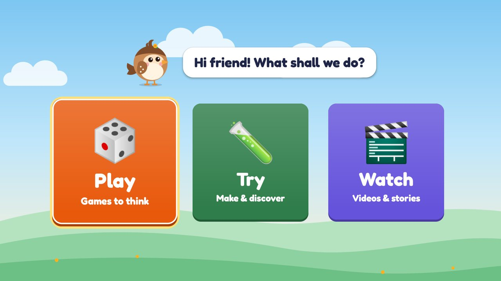
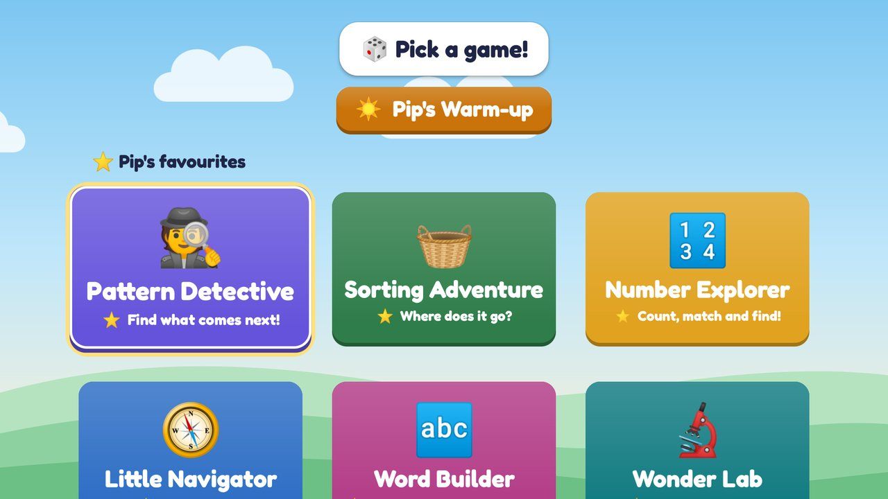
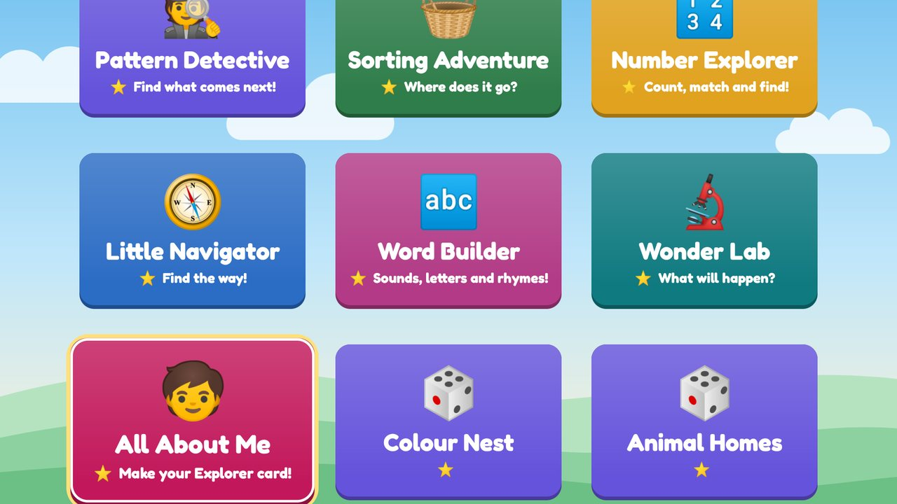
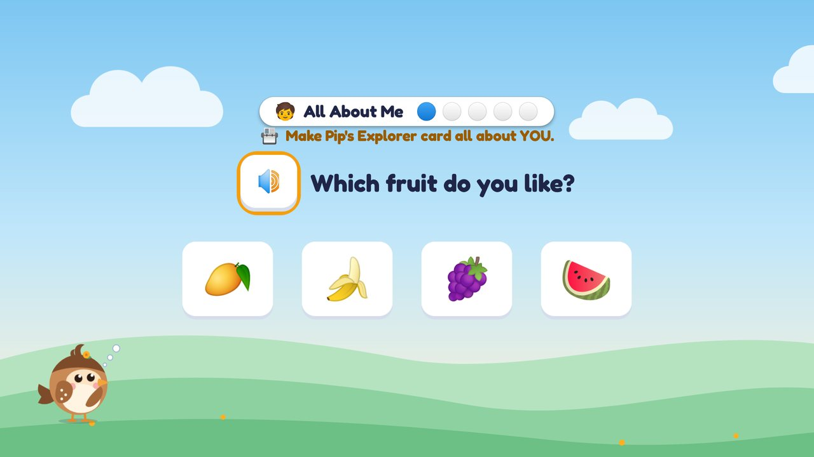
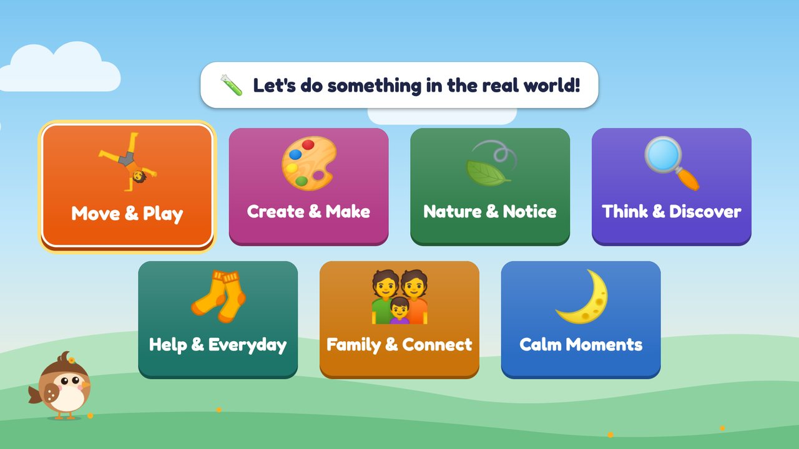
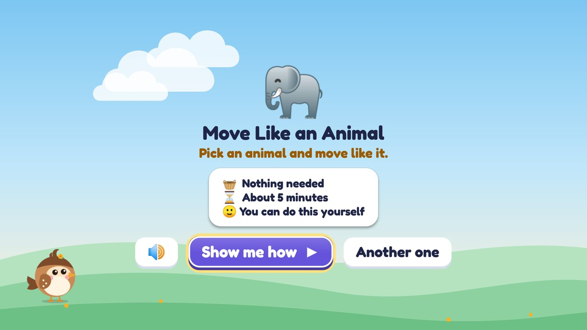
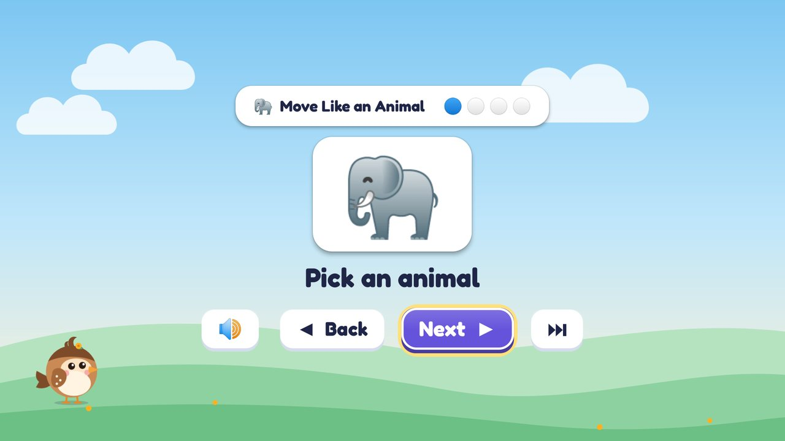

# Wonder Window

**PLAY · TRY · WATCH — Think. Experience. Discover.**

Wonder Window is an open-source, offline-first Android TV experience designed to make screen time more meaningful for children aged 3–10.

## Experience order

1. **PLAY** — first-party interactive educational games.
2. **TRY** — first-party offline real-world activities that invite children to step away from the TV.
3. **WATCH** — provider-neutral video integrations.

PLAY and TRY are first-party. WATCH is a third-party integration boundary and remains isolated from core.

## Principles

- Offline-first/local-first; no account or backend required for core PLAY and TRY.
- No ads, in-app purchases, behavioural tracking, streaks, leaderboards or manipulative engagement loops.
- Parent-configured shared screen-time budget. One shared session manager owns accounting.
- Standard TV remote only: UP, DOWN, LEFT, RIGHT, OK and BACK.
- Parent controls, child safety, accessibility and human content review are release requirements.
- TRY should lead to activity away from the TV. Time away from the TV is not charged as screen use.

## Screenshots

Public edition on a OnePlus Android TV (Android 10, 1920×1080), driven with the standard remote. No family data; the default buddy is Pip.

| Home: PLAY, TRY, WATCH | PLAY: pick a game |
| --- | --- |
|  |  |
| **PLAY: shelves of games** | **PLAY: a picture-answer round** |
|  |  |
| **TRY: real-world activity families** | **TRY: activity preview** |
|  |  |
| **TRY: step by step, then step away from the TV** | |
|  | |

WATCH (parent-curated channel rows played through the YouTube IFrame player) is not pictured, because its tiles show third-party video thumbnails. The UI/UX redesign in progress is tracked in #11 and #12.

## Start with your coding agent

Read `AGENTS.md`, then `PROMPT.md`, the product and architecture docs, and the task prompt matching your contribution. Inspect the existing Android project before making architectural changes. This repository is a contribution blueprint, not a replacement app or a mandate for a framework rewrite.

## Current status (Nov 2026)

`main` is a working prototype, not only a blueprint. It is a single-activity Java Android TV app (`app/`, API 26–34, no AndroidX), tested on one OnePlus TV (Android 10). It contains:

- **Home:** PLAY → TRY → WATCH order (D1).
- **PLAY:** 7 core games plus 65 catalogue games and 13 modes, with adaptive levels.
- **TRY v3:** 10 reviewed activities across 7 families, with a step-away screen that stops the meter.
- **WATCH:** parent-curated channel rows played through the YouTube IFrame player; recently started videos move to the back for 7 days (D8).
- **Screen time:** one shared daily limit set by the parent.

Pre-recorded voice clips are generated locally with `tools/make_voice.py` and are not committed, so the public edition is currently silent (see #12). Not yet done: a parent settings screen and gate on the TV, release signing, and broad device testing. Four safety rounds await owner review in `content/REVIEW_LOG.md` before any public release. See the open issues.

**Build** (Linux, headless; no Mac, TV or voice clips needed): install JDK 17 and the Android SDK (platform 34), then run `./gradlew assemblePublicDebug lintPublicRelease testPublicDebugUnitTest`. The `public` edition never reads `family.properties` and ships only defaults; CI runs this plus `tools/check_public_apk.py`. A personalised `family` edition exists only when explicitly requested (`./gradlew -PwwFamily=true assembleFamilyDebug`). It reads `family.properties` and must never be uploaded or attached to a release. The local macOS helpers (`tools/build-only.sh`, `tools/install-when-ready.sh`, `tools/make_voice.py`) install on a TV and generate optional `say` voice clips; CI doesn't use them.

## Contribution areas

- [PLAY](features/play/README.md)
- [TRY](features/try/README.md)
- [WATCH](features/watch/README.md)
- [Design system](design/README.md)
- [Shared core](core/README.md)

## Validate

```bash
python3 -m pip install jsonschema
python3 tools/validate_content.py
```

See [CONTRIBUTING.md](CONTRIBUTING.md) and [docs/ROADMAP.md](docs/ROADMAP.md).

## License

Source code: MIT. Original written documentation/content: CC BY 4.0 where indicated. Third-party materials retain their own licences.
