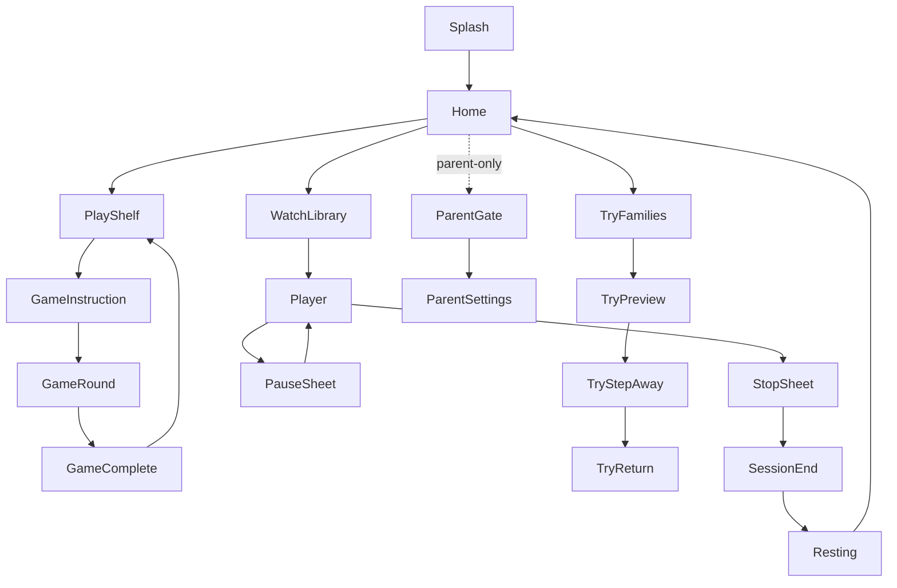

# Navigation, focus, motion and accessibility

## Remote contract

| Key | Behaviour |
|---|---|
| UP/DOWN | Nearest visible enabled target in that direction; otherwise remain |
| LEFT/RIGHT | Previous/next in current row or documented parent route |
| OK | Activate focused target |
| BACK | One level back; never reset time/settings |

No child action depends on touch, pointer, keyboard, voice recognition or phone.

## Screen map

## Focus and BACK map

| Screen | Initial focus | LEFT/RIGHT | UP/DOWN | BACK |
|---|---|---|---|---|
| Home | PLAY | PLAY↔TRY↔WATCH; skip disabled TRY | Stay on doors | No-op/safe exit |
| PLAY shelf | First game tile | Same shelf | Nearest tile adjacent shelf | Home; restore PLAY |
| Game instruction | Start | Start/Hear again/Back | No hidden jump | PLAY shelf |
| Game round | First answer | Answers in order | Adjacent answer row; replay secondary | PLAY shelf |
| Game complete | Choose another/Home | Visible actions | No hidden jump | PLAY shelf |
| TRY families | First safe activity | Within row | Adjacent family/list | Home; restore TRY |
| TRY preview | Step away | Step away/Hear again/Back | No hidden jump | TRY list |
| TRY step-away | Return/Home if shown | Visible actions | No hidden jump | Prior TRY state; preserve meter |
| WATCH library | First approved item | Within row | Adjacent row | Home; restore WATCH |
| Player | Player; controls only on overlay | Seek only when supported | Documented player mode | Pause/stop flow |
| Pause/stop sheet | Safe reversible action | Visible actions | No hidden jump | Close/resume safely |
| Session end/resting | Home or optional TRY | Visible actions | No hidden jump | Home; never reset time |
| Parent gate | First secure input | Defined sequence | Defined sequence | Child home |
| Parent settings | First setting in section | Within group | Adjacent group | Parent gate/child home |

Home exact path: TRY on = PLAY→TRY→WATCH. TRY off = PLAY→WATCH. Boundaries stay; no focus on decorative labels/Pip. Restore last valid focus after returning. Sheets contain focus; initial focus is reversible action; BACK closes only when safe; closing restores opener focus. Disabled controls leave focus order.

## Motion specification

| Motion | Target | Purpose |
|---|---|---|
| Focus | 160 ms ease-out; scale 1.04–1.06; slight lift | Make target obvious |
| Press | 80 ms squash to .97 | Confirm OK |
| Screen transition | 220 ms cross-fade + 8 px rise | Continuity without delay |
| Pip focus reaction | One turn/look or tiny hop after short dwell | Orientation cue |
| Cloud drift | ≤8 px/s, low contrast | Calm atmosphere |
| Success | One pose/scale cue under 350 ms | Acknowledge, not reward |
| Loading/resting | Static pose or slow single fade | No pressure |

No flashing, strobing, rapid particles, bouncing CTA loops, countdown urgency, confetti showers or auto-advance.

## Reduced motion

When `Settings.Global.ANIMATOR_DURATION_SCALE == 0`, all non-essential property animations, cloud drift, focus scaling, screen transitions and Pip movement become static. Focus remains clear through the two-tone edge and shape/elevation. Press feedback can use a non-motion outline state. Treat this as a system animator-scale signal, not a claim that API 26 exposes a complete reduced-motion preference.

Implementation acceptance: read scale safely; handle unavailable access; observe changes where feasible; stop loops when view detaches/activity stops; test scale 0 and normal; verify on device.

## Accessibility and voice

- Meaningful content descriptions where visible label is insufficient.
- Normal text ≥4.5:1; large text and non-text focus boundaries ≥3:1.
- No colour-only or opacity-only state; no precision timing without untimed alternative.
- Long text wraps within safe bounds; sound effects can be disabled.
- Public edition currently may be silent when optional clips are absent. Proposed fallback: on-device Android TextToSpeech only after verifying engine/language data on target TV. Speak first instruction when sound enabled; first focus remains first answer. Keep visible instruction and secondary Hear again action. Do not bundle macOS `say` clips without redistribution-rights review.

## Test scenarios

1. All directions on every screen; no disappearing/jumping focus.
2. Every sheet: open, navigate, BACK, restore opener focus.
3. Home with TRY enabled and disabled.
4. PLAY: first answer focus, 2/3/4 choices, long labels, scrolling, round end.
5. TRY: step away/return; meter integrity.
6. WATCH: pause, next, pick another, stop, provider error, network loss.
7. Parent gate cannot be bypassed.
8. Animator scale 0 and normal.
9. 1280×720, 1920×1080, 3840×2160; overscan and large text.
10. Cold launch, resume, sleep/wake, background/foreground and process death.
